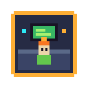
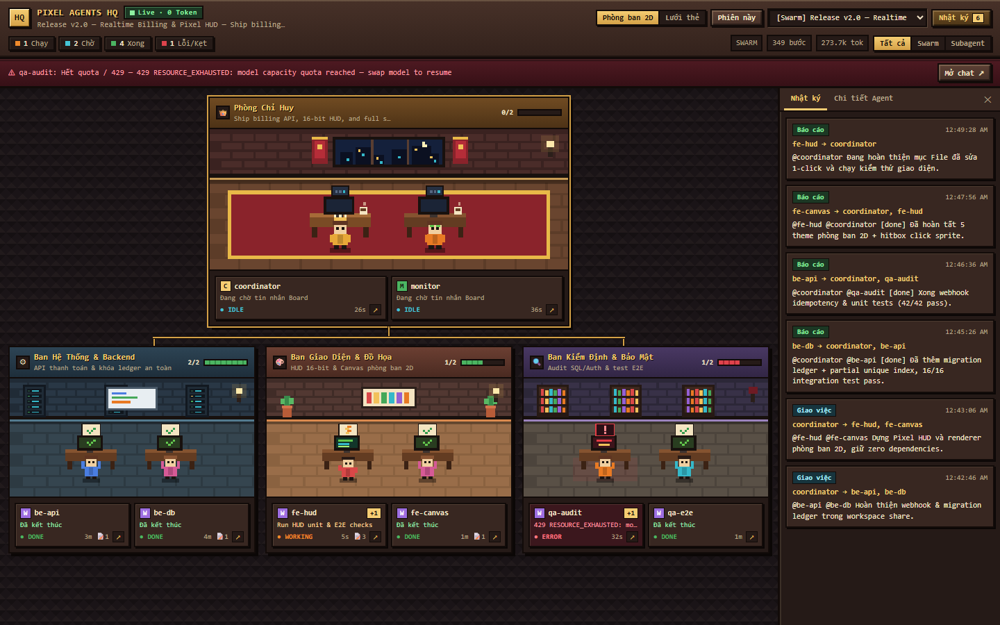
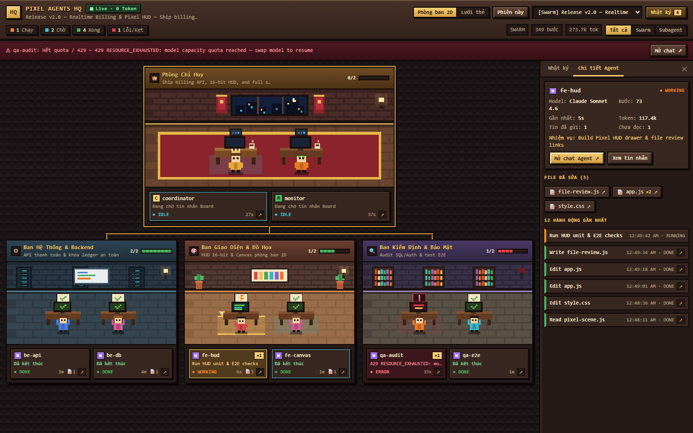

<p align="center">
  
</p>

<h1 align="center">Pixel Agents HQ</h1>

<p align="center">
  <b>16-bit Pixel Game Department HQ — Side Pane Visualizer cho Antigravity Swarm &amp; Subagent Multi-Agent</b><br/>
  <sub>0 AI Tokens · Zero npm Dependencies · Zero Build Step · Native Antigravity Sidecar Plugin</sub>
</p>

---

## Giới thiệu / Overview

**Pixel Agents HQ** biến bảng điều phối multi-agent (`/swarm`, `/teamwork`, `invoke_subagent`) của **Google Antigravity** thành một **trụ sở phòng ban game pixel 2D** chạy ngay ở side pane bên phải.

Plugin đọc trực tiếp (read-only) dữ liệu cục bộ từ `~/.gemini/antigravity/brain/` nên **tốn 0 AI token**, khởi động tức thì, không cần cài `node_modules` hay chạy bundler.

### Ảnh mẫu thực tế / Screenshots

**Sơ đồ Phòng Ban 2D Phân Cấp + Thanh Cảnh Báo + Nhật ký Board trực tiếp**



**Chi tiết Agent — Danh sách File đã sửa (mở 1-click) &amp; 12 hành động gần nhất**



---

## Tính năng chính / Features

- **Sơ đồ Phòng Ban 2D Phân Cấp (`Phòng ban 2D` &amp; `Lưới thẻ`)**:
  - **Tầng trên — Phòng Chỉ Huy**: hiển thị `Coordinator`, `Monitor`, `Narrator` trên nền gỗ/thảm đỏ.
  - **Tầng dưới — Các Phòng Ban chuyên môn**: tự động nhóm theo `threads` trong `plan.json` (hoặc tự phân ban thông minh theo tên/vai trò: *Backend / Server*, *UI &amp; Đồ họa*, *Kiểm định &amp; Nghiên cứu*, *Thực thi*) kèm thanh tiến độ chia vạch kiểu RPG.
  - Click trực tiếp lên **nhân vật pixel ngay trong canvas** để soi chi tiết và highlight các agent liên kết giao tiếp.
- **Hỗ trợ cả Native Swarm lẫn Subagent**: đọc đồng thời `members.json` + `board.jsonl` + `plan.json` (Swarm) và `invoke_subagent` / `send_message` (Subagent) từ `transcript.jsonl`.
- **Thanh Cảnh Báo Nóng (Attention Strip)**: tự nổi cảnh báo trên cùng khi có agent gặp lỗi, hết quota (`429`), kẹt không tiến triển >10 phút (`STUCK`), hoặc Coordinator đang dừng chờ bạn trả lời — kèm nút **`Mở chat ↗`**.
- **File đã sửa &amp; Timeline 12 bước mở 1-click**: xem danh sách file agent vừa `edit_file`/`write_file` và 12 bước gần nhất; bấm **`↗`** để mở thẳng file sang tab bên cạnh trong Antigravity để review ngay.
- **0 Token AI &amp; Siêu nhẹ**: đọc cửa sổ đuôi (tail-read) + cache theo `mtime`/`etag`, quét hàng trăm phiên trong ~100ms, tự tạm dừng animation &amp; polling khi ẩn tab.

---

## Cài đặt nhanh / Quick Install

Yêu cầu: **Antigravity App** (có sẵn Node.js và `sidecar_sdk`). Không cần `npm install` hay build.

### Windows (PowerShell)

```powershell
git clone https://github.com/luongviettienns/pixel-agents-hq.git "$HOME\.gemini\config\plugins\pixel-agents"
```

### macOS / Linux

```bash
git clone https://github.com/luongviettienns/pixel-agents-hq.git ~/.gemini/config/plugins/pixel-agents
```

### Kích hoạt &amp; Mở trong Antigravity

1. Antigravity tự phát hiện plugin mới trong `~/.gemini/config/plugins/pixel-agents/`.
2. Mở mục **Customizations → Plugins** và đảm bảo **Pixel Agents HQ** đang bật (`Enabled`).
3. Ở góc trên bên phải khung **Side Pane**, bấm nút **`+`** → chọn **Pixel Agents HQ**.

### Cập nhật bản mới

```bash
git -C ~/.gemini/config/plugins/pixel-agents pull
```
*(Nếu có cập nhật ở `store.mjs` hoặc `main.mjs`, tắt rồi bật lại plugin 1 lần trong Customizations để sidecar nạp backend mới.)*

---

## Mẹo để phân phòng ban đẹp nhất với Swarm

Khi điều phối Swarm, hãy để Coordinator ghi file `plan.json` tại `<appData>/brain/<convId>/.system_generated/swarm/plan.json` (theo chuẩn `swarm_pane`):

```json
{
  "goal": { "title": "Release v2.0", "line": "Ship API, HUD, and E2E tests." },
  "tasks": { "be-api": "Build billing webhook", "fe-hud": "Build Pixel HUD" },
  "threads": [
    { "id": "t-be", "title": "Ban Hệ Thống & Backend", "goal": "API & DB", "tasks": ["be-api"] },
    { "id": "t-fe", "title": "Ban Giao Diện & Đồ Họa", "goal": "UI 16-bit", "tasks": ["fe-hud"] }
  ]
}
```

Nếu phiên không có `plan.json` (ví dụ phiên cũ hoặc phiên Subagent), plugin tự phân phòng ban thông minh dựa trên vai trò và tiền tố tên agent (`be-*`, `fe-*`, `qa-*`, `audit`, `research`, `docs`...).

---

## Kiến trúc gọn nhẹ &amp; Cách mở rộng

```text
pixel-agents-hq/
├── plugin.json                     # Khai báo plugin Antigravity
├── assets/logo.svg                 # Icon pixel của plugin
└── sidecars/pixel_hq/
    ├── sidecar.json                # Cấu hình Aux Pane Web UI
    ├── store.mjs                   # Engine đọc dữ liệu read-only (Swarm, Subagent, Transcript)
    ├── main.mjs                    # HTTP server mỏng trên sidecar_sdk (/api/sessions, /api/state)
    ├── pixel-scene.js              # Renderer Canvas 2D tách riêng (5 theme phòng ban + sprite)
    ├── index.html & style.css      # Giao diện 16-bit RPG bằng CSS variables
    ├── app.js                      # Controller UI (polling etag, Inspector, Feed, Hitbox)
    └── test.mjs                    # Bộ unit test bằng node --test (0 dependency)
```

- **Đổi màu / thêm theme phòng**: chỉnh biến `:root` trong `style.css` và bảng `ROOM_THEMES` trong `pixel-scene.js`.
- **Thay sprite PNG (Aseprite)**: chỉ cần thay hàm vẽ nhân vật trong `pixel-scene.js`, giữ nguyên toàn bộ backend và UI.
- **Chạy test cục bộ**:

```bash
node --test sidecars/pixel_hq/test.mjs
```

---

## Giấy phép / License

[MIT](LICENSE)
